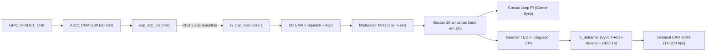

# Projeto do Receptor 4-QAM (ESP32-WROOM-32 + ADC1 DMA)

Este documento descreve o firmware do receptor independente em [`receiver/`](../receiver/), cobrindo a aquisição contínua por DMA, o condicionamento analógico digitalizado, o pipeline demodulador e o desenquadrador com resolução automática de quadrante.

---

## 1. Fluxo de Execução e Módulos (`receiver/main/`)

---

## 2. Aquisição Contínua `ADC1 DMA` (`adc_sampler.c`)

O driver [`adc_sampler.c`](../receiver/main/adc_sampler.c) opera o controlador digital interno do ADC1 acoplado ao DMA do `I2S0`:

- **Canal padrão:** `ADC1_CHANNEL_6` (`GPIO 34` no ESP32-WROOM-32, pino somente-entrada).
- **Atenuação:** `ADC_ATTEN_DB_12` (nomenclatura atualizada de `ADC_ATTEN_DB_11` no IDF 4.4.8), proporcionando faixa útil linear de **`150 mV` a `2450 mV`**.
- **Calibração `eFuse` (`esp_adc_cal`):** caracteriza `Vref` / `TwoPoint` gravados na fábrica (ou fallback `1100 mV`) e converte cada palavra de 12 bits (`0..4095`) diretamente para milivolts (`float mV`).
- **Configuração obrigatória específica do chip ESP32 em IDF 4.4.8:**
  - `.conv_mode = ADC_CONV_SINGLE_UNIT_1`
  - `.format = ADC_DIGI_OUTPUT_FORMAT_TYPE1` (`2 bytes/amostra`)
  - `.conv_limit_en = true` e `.conv_limit_num = 250` (exigido pelo HAL `driver/adc.c` no ESP32)
  - `.unit = 0` (`ADC_NUM_1` no formato de padrão DMA, diferente de `ADC_UNIT_1 = 1`!)
  - `.sample_freq_hz >= 20000` (limite inferior do DMA no `soc_caps.h` do ESP32; padrão = **`20.000 Hz`** = `20` amostras por ciclo de `1 kHz` e `200` amostras por símbolo de `100 baud`).

---

## 3. Pipeline DSP por Amostra (`qam_demod.c`)

A cada amostra `sample_mv` recebida em `qam_demod_process_sample()`:

1. **Remoção adaptativa de DC:** filtro EMA de 1º ordem estima $V_{DC}$ (`alpha = 0,0050` em silêncio para convergência rápida; `alpha = 0,0010` durante sinal ativo para não distorcer a envoltória) e extrai $x_{AC} = V_{\text{in}} - \hat{V}_{DC}$.
2. **Squelch com histerese e AGC:** estima potência $P$ (`beta = 0,02`) e amplitude de pico $\hat{V}_{pk} = \sqrt{2}\,V_{RMS}$.
   - **Início de rajada:** exige `rms_mv >= squelch_rms_mv` (`60 mV` RMS padrão) por `8` amostras consecutivas; dispara `burst_started` e zera integradores/malhas (`qam_demod_reset_tracking`).
   - **Fim de rajada:** se `rms_mv < 0,45 * squelch_rms_mv` por `quiet_limit_samples` ($2{,}5\,T_s$, mínimo `40` amostras), sinaliza `burst_ended` e limpa rajadas parciais do Modo 1.
   - **Normalização AGC:** divide $x_{AC}$ por $\hat{V}_{pk}$ para que a constelação ideal estabilize próximo a $(\pm 0{,}7071,\ \pm 0{,}7071)$.
3. **Mistura em quadratura + Boxcar:** multiplica por $2\cos(\theta_{\text{NCO}})$ e $\pm 2\sin(\theta_{\text{NCO}})$ (sinal ajustado por `q_sign_minus`) e aplica média móvel (*boxcar*) de `box_len = round(fs/fc) = 20` amostras, produzindo um **zero exato em $2f_c = 2000\text{ Hz}$**.
4. **Recuperação de portadora (`Costas Loop` PI)** e **Recuperação de símbolo (`Gardner TED`)**: detalhados em [`sincronizacao.md`](./sincronizacao.md).
5. **Integrador de platô e estimativa de SNR:** acumula `(i_b, q_b)` apenas no núcleo estável do símbolo (`0,15 <= sym_phase <= 0,85` = `70%` centrais), evitando a zona de transição do filtro boxcar, e estima a SNR a partir do EVM até $(\pm 0{,}7071, \pm 0{,}7071)$.

---

## 4. Máquina de Estados do Desenquadrador (`rx_deframer.c`)

- **Modo 2 (`RX_MODE_2_FRAMED`, padrão):**
  1. `RX_STATE_SYNC_SEARCH`: mantém janela deslizante com os últimos `sync_word_len * 4` símbolos (`8` símbolos para `0xD3 0x91`) e testa **simultaneamente as 4 rotações ($0^\circ, 90^\circ, 180^\circ, 270^\circ$)** via `rx_mapper_decide_symbol()`. Ao detectar casamento exato, trava `locked_rot`.
  2. `RX_STATE_HEADER`: lê `4 bytes` em `MSB-first`, valida versão (`0x1`), `order <= 2` e `payload_len <= 240`, extraindo `tx_baud` e `payload_order`.
  3. `RX_STATE_PAYLOAD`: decodifica exatamente `payload_len` bytes usando `payload_order`.
  4. `RX_STATE_CRC`: lê `2 bytes` em `MSB-first` e compara com `rx_crc16_ccitt(hdr + payload)`, imprimindo o texto e informando `CRC OK` ou `CRC ERR` no console.
- **Modo 1 (`RX_MODE_1_RAW_STREAM`):**
  - Se `mode1_use_sync_word = true` (`/sync1 1`), resolve rotação pela `Sync Word` e então entra em `RX_STATE_RAW_STREAM`.
  - Se `mode1_use_sync_word = false` *(padrão Modo 1)*, vai direto para `RX_STATE_RAW_STREAM` aplicando a rotação manual `/rot <0|90|180|270>`, e imprime a linha ASCII ao encerrar a rajada (`flush_raw_burst_line`).

---

## 5. Guia Completo de Comandos UART CLI do Receptor (`115200 bps`)

| Comando | Descrição | Padrão inicial |
|---|---|---|
| `/status` | Exibe modo, canal ADC1 (`GPIO`), `fs`, `DC`, `Vpk`, `df`, `(I,Q)` e contadores | — |
| `/mode <1\|2>` | `1` = Fluxo bruto ASCII (Modo Professor), `2` = Quadro + Sync + CRC-16 | `2` |
| `/fc <hz>` | Frequência esperada da portadora (`100 .. 10000 Hz`) | `1000` |
| `/baud <baud>` | Taxa nominal de símbolos esperada (`5 .. 2000 baud`) | `100` *(provisório)* |
| `/fs <hz>` | Taxa de amostragem do ADC1 DMA (`20000 .. 80000 Hz`) | `20000` |
| `/ch <0..7>` | Seleciona canal ADC1 (`ch 6 = GPIO 34`) | `6` |
| `/map <natural\|gray>` | Tabela de constelação esperada | `natural` |
| `/qsign <plus\|minus>` | Convenção de quadratura (`+cos(wt-90)`/`+sin` vs `-sin`) | `plus` |
| `/order <msb\|lsb_bit\|lsb_dibit>` | Ordem dos bits esperada no Modo 1 | `msb` |
| `/pol <norm\|inv>` | Inversão de polaridade na entrada | `norm` |
| `/rot <0\|90\|180\|270>` | Rotação manual de quadrante para Modo 1 sem sync | `0` |
| `/sync1 <0\|1>` | Exige busca de `Sync Word` (`0xD3 0x91`) no Modo 1 | `0` |
| `/squelch <mv>` | Limiar AC RMS de detecção de portadora (`5 .. 1000 mV`) | `60.0` |
| `/monitor <0\|1>` | Imprime telemetria ao vivo `(I, Q)`, `SNR (dB)` e `df (Hz)` por símbolo | `0` |
| `/selftest` | Roda auto-teste em malha fechada (3 cenários sintéticos com deriva e ruído) | Roda no boot |
| `/reset` | Restaura configuração padrão | — |
| `/help` | Exibe lista de comandos | — |
