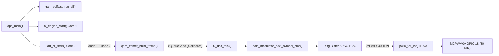

# Projeto do Transmissor 4-QAM (ESP32-WROOM-32 + MCPWM)

Este documento detalha o firmware do transmissor em [`transmitter/`](../transmitter/), cobrindo a geração determinística do sinal via `MCPWM0`, o modulador em banda passante sem deriva de frequência e todos os comandos da interface CLI.

---

## 1. Fluxo de Execução e Módulos (`transmitter/main/`)

---

## 2. Por que `MCPWM0` Simétrico a `80 kHz` (em vez de `LEDC`)?

Em ESP32 (`ESP-IDF v4.4.8`, `160 MHz`), ambos os periféricos oferecem PWM em hardware, mas **`MCPWM_UNIT_0` em modo simétrico (`UP_DOWN_COUNTER`)** foi escolhido pelos seguintes motivos de engenharia:

| Critério | `MCPWM0` (`UP_DOWN_COUNTER`) utilizado | `LEDC` High-Speed |
|---|---|---|
| **Clock base e resolução a `80 kHz`** | Clock **`160 MHz`** (`SOC_MCPWM_BASE_CLK_HZ`) $\rightarrow$ `period = 1000` ticks (`~10 bits` reais) | Base `80 MHz` $\rightarrow$ no máximo `~9–10 bits`, exigindo ajuste manual de divisor fracionário |
| **Atualização síncrona *shadow* (`TEZ`)** | `mcpwm_ll_operator_set_compare_value` com carregamento **estritamente em `TEZ`** (zero do contador), desabilitando `TEP` $\rightarrow$ zero *glitches* de largura de pulso | Atualização via `ledc_update_duty()` é mais lenta por API de alto nível e assíncrona fora de ISR |
| **Espectro de chaveamento** | Portadora PWM em **`80.000 Hz`** (`fs = 40.000 Hz` por subdivisão `2:1`), permitindo filtro RC passivo simples de 2ª ordem com `-48,8 dB` em `80 kHz` | Frequência PWM limitada pela resolução desejada |
| **Determinismo de ISR** | `pwm_tez_isr()` residente em **`IRAM_ATTR`** com ring buffer em **`DRAM_ATTR`**, imune a acessos à Flash SPI | Depende de chamada por timer auxiliar |

> **Armadilha crítica corrigida do ESP-IDF v4.4.8:** a função `mcpwm_init()` inicializa o timer em `1 MHz` e habilita carga de shadow também em `TEP` quando `UP_DOWN_COUNTER` está ativo. Em [`pwm_driver.c`](../transmitter/main/pwm_driver.c), o driver configura explicitamente `mcpwm_group_set_resolution` + `mcpwm_timer_set_resolution` em `160.000.000 Hz`, corrige o pico com `mcpwm_ll_timer_set_peak(..., true)` e força atualização exclusivamente no evento `TEZ`.

---

## 3. Síntese Numérica Sem Deriva (`qam_modulator.c`)

Para evitar acúmulo de erro de ponto flutuante após horas de operação, [`qam_modulator.c`](../transmitter/main/qam_modulator.c) utiliza:
1. **Tabela senoidal (`LUT`) de `1024` pontos** sobre um período completo (`0..1 volta`) com **interpolação linear**.
2. **Acumuladores inteiros racionais exatos**:
   - Portadora: `carrier_phase_num = (carrier_phase_num + fc) % fs`. Para `fc = 1000 Hz` e `fs = 40000 Hz`, cada ciclo tem **exatamente `40` amostras** sem deriva acumulativa.
   - Duração de símbolo: `sym_phase_num += Rs`; quando `sym_phase_num >= fs`, subtrai `fs` e sinaliza `symbol_finished = true`. Para `Rs = 100 baud`, cada símbolo dura **exatamente `400` amostras** (`10,000 ms`).
3. **Quantização e proteção de comparador (`mv_to_pwm_cmp`)**:
   $$\text{ticks} = \operatorname{round}\!\left(\frac{v(t)}{V_{DD}}\cdot P_{\text{ticks}}\right)$$
   limitado defensivamente ao intervalo `[1 .. period_ticks - 1]` (ex.: `1..999` para `period_ticks = 1000`) para evitar colisão de comparador em `0%` ou `100%` de *duty cycle*.

---

## 4. Guia Completo de Comandos UART CLI (`115200 bps`)

Qualquer texto digitado sem barra `/` inicial é transmitido imediatamente no modo ativo (`Modo 1` ou `Modo 2`):

| Comando | Descrição | Padrão inicial |
|---|---|---|
| `<texto>` ou `/send <texto>` | Envia mensagem ASCII/texto (até `240 bytes`) | — |
| `/status` | Exibe modo, `fc`, `Rs`, `fs`, PWM, faixa mV e contadores/underruns | — |
| `/mode <1\|2\|3>` | `1` = Professor (puro), `2` = Quadro + Sync + CRC-16, `3` = Contínuo | `Modo 2` (`tx_mode = 2`) |
| `/fc <hz>` | Portadora em Hz (`50 .. 20000`) | `1000` |
| `/baud <baud>` | Taxa de símbolos (`1 .. 5000`) | `100` *(provisório)* |
| `/fs <hz>` | Taxa de amostras (`4000 .. 100000`, divisor inteiro de `f_pwm`) | `40000` |
| `/pwm <hz> [sym\|asym]` | Frequência PWM (`10000 .. 200000`) e contagem simétrica/assimétrica | `80000 sym` |
| `/amp <mv>` | Amplitude de pico $V_{pk}$ em mV ($\ge 50\text{ mV}$) | `900` |
| `/offset <mv>` | Nível DC pós-filtro em mV | `1300` |
| `/order <msb\|lsb_bit\|lsb_dibit>` | Ordem dos bits dentro de cada byte ASCII | `msb` |
| `/map <natural\|gray>` | Constelação ativa (`natural`: `0=(-1,-1)..3=(+1,+1)`) | `natural` |
| `/qsign <plus\|minus>` | `+cos(wt-90)` (`+sin`) vs `-sin` | `plus` |
| `/pol <norm\|inv>` | Polaridade normal ou invertida do sinal | `norm` |
| `/pulse <rect\|taper>` | Pulso retangular ou janela suavizada (`10%` nas bordas) | `rect` |
| `/idle <dc\|pilot>` | Em repouso: silêncio em `Vdc` ou piloto contínuo de símbolo `00` | `dc` |
| `/pre1 <0\|1> [0\|1]` | No Modo 1: habilita/desabilita preâmbulo e sync word | `0 0` |
| `/gpio <pino>` | Altera pino PWM de saída no ESP32 | `18` |
| `/test <subcmd>` | Inicia Modo 3 contínuo: `carrier`, `sym00`, `sym01`, `sym10`, `sym11`, `cycle`, `text <msg>`, `stop` | `stop` |
| `/verbose <0\|1>` | Mostra decomposição hex $\rightarrow$ bits $\rightarrow$ $(I, Q)$ por caractere | `1` |
| `/vectors` | Imprime tabela ativa e vetores de `'A'` e `'B'` no terminal | — |
| `/selftest` | Roda bateria embarcada de 6 verificações matemáticas e segurança | Roda no boot |
| `/reset` | Restaura toda a configuração padrão de fábrica | — |
| `/help` | Exibe ajuda resumida | — |
